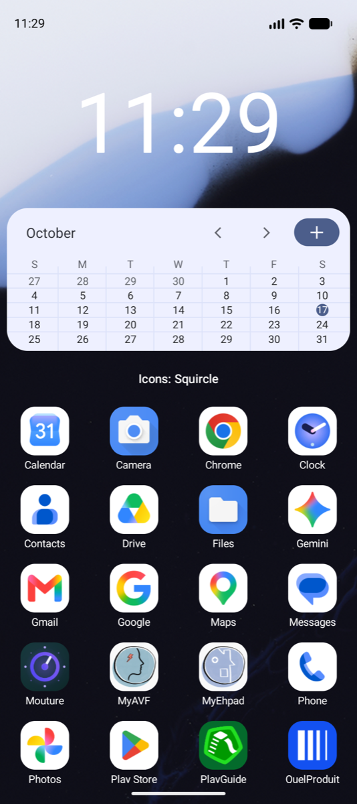

# Tiny Launcher

A tiny Android home screen built step by step for the talk
*Building my own Android launcher (and rediscovering Android basics along the way)*.

<p align="center">
  
</p>

Each checkpoint is a git tag. Play the game yourself:

```bash
git checkout cp-0 && ./gradlew installDebug
```

| Tag | Unlocks | Classic we meet |
| --- | --- | --- |
| `cp-0` Start | The empty Compose template | Nothing yet |
| `cp-1` Home | Home app, wallpaper, a big clock that bounces when you press Home | Intent filters, RoleManager, singleTask + onNewIntent, the task stack |
| `cp-2` Drawer | App drawer for every profile, launched with the right animation | LauncherApps, package visibility, profiles |
| `cp-3` Sync | The clock ticks, the drawer updates itself | BroadcastReceiver (TIME_TICK), LauncherApps.Callback, callbackFlow |
| `cp-4` Icons | Real icons, a shape switcher, themed icons from the wallpaper color | AdaptiveIconDrawable, monochrome layer, WallpaperColors |
| `cp-5` Widgets | Hosts one widget on the home screen | AppWidgetHost, binding, listening |

## Become the home app from the command line

```bash
adb shell cmd role get-role-holders android.app.role.HOME
adb shell cmd package set-home-activity dev.tiny.launcher/.MainActivity
adb shell input keyevent KEYCODE_HOME
```

Requirements: Android Studio with SDK 37, minSdk 26.

## UI tests (Maestro)

The `.maestro` suite checks one feature per checkpoint against the final app (`cp-5`).
With a device or emulator connected:

```bash
./scripts/maestro-test.sh                      # full suite, about 1 min 30 s
./scripts/maestro-test.sh --exclude-tags slow  # skip the one-minute clock tick
./scripts/maestro-test.sh -e WIDGET="Chrome Dino"
```

The script installs the debug build and makes Tiny Launcher the home app before running the flows.
Each flow restarts the launcher with `stopApp` + Home, so the system starts the home activity once.
